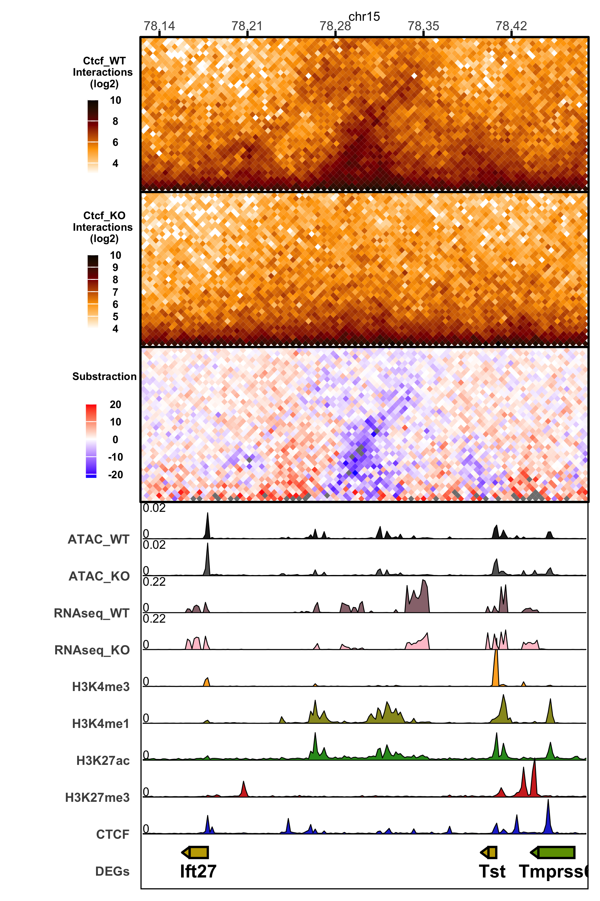

# plotterHiC

A minimalist R tool for visualizing differential Hi-C matrices in a 45° rotated square layout together with epigenomic tracks and gene annotations.

---

## Features

- Visualization of Hi-C matrices in a rotated triangular representation
- Differential Hi-C comparison between conditions
- Support for:
  - normalized interaction matrices
  - subtraction matrices
  - ratio matrices
- Multi-track genomic browser visualization
- BigWig signal integration
- Gene annotation tracks with strand direction
- Shared scaling between epigenomic tracks
- Customizable legends, scales, colors, and layouts
- Publication-ready compact figures

---

## Example

### Differential Hi-C visualization

<!-- Replace with your figure -->

<p align="center">
  
</p>

---

### Epigenomic tracks and gene annotations

<!-- Replace with your figure -->

<p align="center">
  
</p>

---

## Installation

### Clone repository

```bash
git clone https://github.com/YOUR_USERNAME/plotterHiC.git
cd plotterHiC
```

---

## Dependencies

### CRAN packages

```r
install.packages(c(
  "dplyr",
  "ggplot2",
  "data.table",
  "parallel",
  "grid",
  "raster",
  "patchwork"
))
```

### Bioconductor packages

```r
install.packages("BiocManager")

BiocManager::install(c(
  "GenomicRanges",
  "rtracklayer"
))
```

### strawr

Used for reading `.hic` files from Juicer.

```r
remotes::install_github("aidenlab/straw/R")
```

---

## Input files

The pipeline supports:

- `.hic` Hi-C matrices
- BigWig (`.bw`) epigenomic tracks
- BED gene annotations

Supported genomes:

- mm10
- hg38
- hg19

---

## Usage

```bash
Rscript plotterHiC.r configuration-file region-to-plot
```

### Example

```bash
Rscript plotterHiC.r plotter_config.sh chr1:78000000:78600000
```

---

## Configuration file

The configuration file controls:

- Hi-C matrices
- matrix visualization modes
- track colors
- track scaling
- legend parameters
- plot proportions
- genomic tracks
- output directories

Example:

```bash
nomen: example_plot
genome_reference: mm10
hic_directories: data/hic/
hic_file_ctrl: WT.hic
hic_file: KO.hic
matrix_choices: log2 substraction ratio
```

---

## Matrix visualization modes

| Mode | Description |
|---|---|
| `log2` | Log2 normalized interaction matrix |
| `substraction` | Difference between conditions |
| `ratio` | Interaction ratio between conditions |

---

## Plot layout

The final figure combines:

1. Hi-C matrix panels
2. Epigenomic signal tracks
3. Gene annotations

using:

```r
patchwork::plot_layout()
```

---

## Normalization

Hi-C matrices are normalized using chromosome-wide average interaction frequencies:

```r
norm := counts / avg_o
```

---

## Output

The script exports publication-quality figures in:

- PNG
- PDF

Example output:

```text
example_plot.chr1_78000000_78600000.3000_bins.hicplot.png
```

---

## Repository structure

```text
plotterHiC/
├── plotterHiC.r
├── config/
├── data/
├── figures/
├── output/
└── README.md
```

---

## Notes

- The current implementation is under active development.
- The command-line logic and configuration structure may change in future versions.
- Additional support for automated region parsing and modular plotting is planned.

---

## Author

Oscar Amaury Aguilar Lomas

---

## License

MIT License
```
